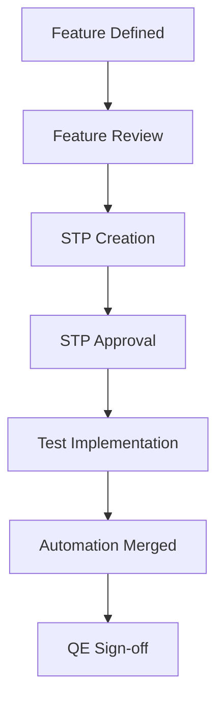

# OpenShift Virtualization Quality Engineering Repository

This repository manages Quality Engineering (QE) artifacts, test plans, and testing strategies for OpenShift Virtualization enhancements, ensuring features meet defined quality standards before release.

## Purpose

Centralize QE documentation and test planning to ensure:

- **Clear visibility** of test coverage, resources, and risks
- **Systematic quality assurance** for all OpenShift Virtualization features
- **Formal QE sign-off** requirements are met
- **Automation is merged for GA** (mandatory)

## Quick Start

### For QE Engineers

1. **New Feature?** → Start with the [STP Guide](./docs/stp-guide.md)
2. **Planning Tests?** → Read [Testing Tiers Guide](./docs/testing-tiers.md)
3. **Writing STP?** → Use the [STP Template](./stps/stp-template/stp.md)

### For Developers

- **Understanding QE Process** → See [STP Guide](./docs/stp-guide.md)
- **Test Requirements** → Review [Testing Tiers](./docs/testing-tiers.md)
- **Approval Process** → Check [Process Flow](#process-flow-feature-to-qe-sign-off)

## Documentation

### Core Guides

| Guide                                          | Description                                                                        |
|:-----------------------------------------------|:-----------------------------------------------------------------------------------|
| [STP Guide](./docs/stp-guide.md)               | Guide to Software Test Plans: purpose of each part, lifecycle, and best practices   |
| [Testing Tiers Guide](./docs/testing-tiers.md) | Differences between Unit Tests, Tier 1 (Functional), Tier 2 (End-to-End), and Tier 3 (Extended) tests |
| [Review Personas](./docs/review-personas/README.md) | Reviewer personas for STP pull requests — one per review focus, one per approver role |

### Templates

| Template                                   | Purpose                                         |
|:-------------------------------------------|:------------------------------------------------|
| [STP Template](./stps/stp-template/stp.md) | Software Test Plan template for feature testing |
| [Child STP Template](./stps/stp-template/child-stp.md)      | Per-SIG child STP for multi-SIG features        |

## Key Concepts

### Glossary

| Term       | Definition                                                            |
|:-----------|:----------------------------------------------------------------------|
| **STP**    | Software Test Plan - Overall roadmap for testing                      |
| **NFR**    | Non-Functional Requirements (performance, security, monitoring, etc.) |
| **Tier 1** | Functional tests covering individual features                         |
| **Tier 2** | End-to-end tests covering complete workflows                          |
| **Tier 3** | Extended validation tests with higher execution cost                   |

### Testing Tiers

```text
Unit Tests → Tier 1 (Functional) → Tier 2 (End-to-End) → Tier 3 (Extended)
  Many          Moderate              Few                    Fewest
Isolated       Feature-level      Full Integration      Dedicated Cycles
```

See [Testing Tiers Guide](./docs/testing-tiers.md) for details.

## Process Flow: Feature to QE Sign-off



### Milestones

1. **Feature Review (Pre-STP)**
   - QE reviews feature requirements and enhancements
   - Developer Handoff/QE Kickoff meeting
   - Confirms testability and acceptance criteria

2. **STP Creation**
   - Document scope, strategy, environment, risks
   - Define Tier 1 and Tier 2 test coverage (Tier 3 where applicable)
   - List untestable aspects with stakeholder agreement

3. **Enhancement Freeze (EF)**
   - STP written, reviewed, and approved
   - Entry criteria met before testing begins

4. **Test Implementation**
   - Develop test cases per STP
   - Implement automation
   - Track against testing goals

5. **Code Freeze (CF)**
   - **Test automation must be merged for GA**
   - All high-priority defects resolved
   - Automation merged and acceptance criteria verified

6. **QE Sign-off**
   - Feature meets all acceptance criteria
   - Automation running in release checklist jobs
   - Documentation reviewed and approved

## Development Setup

### Markdown Linting

This repository uses automated linting to maintain consistent Markdown formatting.

#### Repository Tools

| Tool | Purpose |
|------|---------|
| `tools/check_stp_moves.py` | Validates existing moved-STP stubs as part of pre-commit. |

#### Prerequisites

Install uv first using your package manager or the [official guide](https://docs.astral.sh/uv/getting-started/installation/), then install pre-commit:

```bash
export PATH="$HOME/.local/bin:$PATH"
uv tool install pre-commit
uv tool update-shell
export PATH="$HOME/.local/bin:$PATH"
pre-commit install
```

#### Running Linters

```bash
# Run all pre-commit hooks manually
pre-commit run --all-files

# Run on specific files
pre-commit run --files README.md docs/stp-guide.md

```

The move validator and its tests use pre-commit-managed Python environments and run in both local pre-commit and pre-commit.ci. See `.markdownlint.yaml` for complete Markdown configuration with detailed comments for each rule.

## Responsibilities

### QE Owner

The Quality Owner is the QE sign-off function, and must be someone other than the STP author — normally the
author's lead. The QE Owner(s) named in the metadata own and write the testing plan; they do not sign it off.

- Write and maintain STP
- Review design and identify testing challenges
- Ensure NFRs are addressed
- Manage risks and document untestable aspects
- Ensure automation runs in release checklist jobs

### Stakeholders (Feature Owner, Quality Owner, Product Manager)

- Sign off the STP per the sign-off functions in the [STP Guide](./docs/stp-guide.md)
- Agree to risks associated with untestable aspects
- Coordinate feature enhancement and STP reviews

## Common Questions

| Question                                      | Answer                                                                                    |
|:----------------------------------------------|:------------------------------------------------------------------------------------------|
| **Do PRs need STP sign-off?**                 | No. Code PRs are approved by the SIG as usual; the STP itself is signed off by the Feature Owner, Quality Owner and Product Manager (see the [STP Guide](./docs/stp-guide.md)). |
| **What if PRs miss the deadline?**            | STP author files for an exception; maintainers decide based on context.                   |
| **How to raise attention for my STP?**        | Join bi-weekly QE recurring meetings to introduce your STP.                               |
| **What if feature relates to multiple SIGs?** | One SIG must own it. Reach out to other relevant SIGs for review.                         |

## Resources

### Internal

- [STP Guide](./docs/stp-guide.md)
- [Testing Tiers Guide](./docs/testing-tiers.md)
- [STP Template](./stps/stp-template/stp.md)
- [Child STP Template](./stps/stp-template/child-stp.md)
- [Review Personas](./docs/review-personas/README.md)

## Contributing

1. Create the STP from the [template](./stps/stp-template/stp.md), which defines structure and format
2. Follow the [STP Guide](./docs/stp-guide.md) for purpose and process
3. Ensure proper test tier coverage per [Testing Tiers Guide](./docs/testing-tiers.md)
4. Review the PR with the [review personas](./docs/review-personas/README.md) — run the section
   personas its run matrix assigns to you, and let each approver run their own lens
5. Get stakeholder approval before testing begins
6. Ensure automation is merged before GA

## Support

For questions or assistance:

- Join QE bi-weekly meetings
- Open an issue in this repository
- Contact the QE team lead
